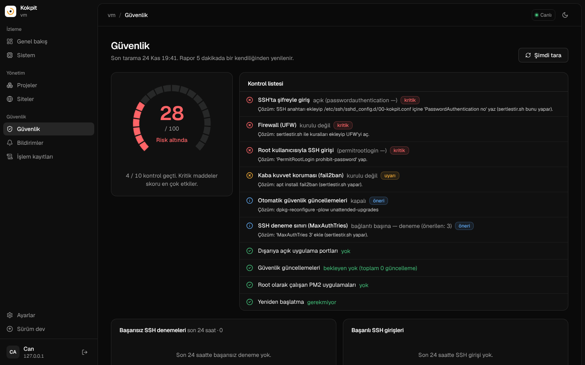
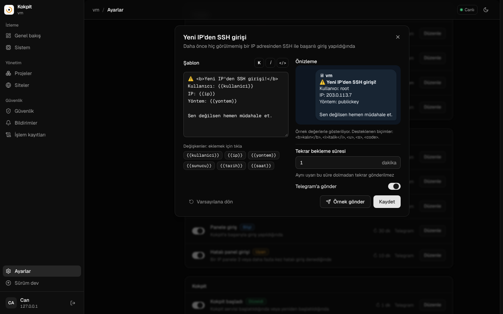

<p align="center">
  
</p>

<h1 align="center">Kokpit</h1>

<p align="center"><b>Sunucunun kokpiti.</b> Linux sunucun için güvenlik odaklı, tek dosyalık web kontrol paneli.</p>

Sunucunun durumunu, çalışan projelerini ve güvenliğini tek ekrandan izler; servisleri yönetir, bir şey ters gidince Telegram'dan haber verir.

- **Tek dosya:** Arayüz dahil tek bir Go binary'si (~8 MB). Node, veritabanı veya Docker gerekmez.
- **Hafif:** Çalışırken ~15 MB RAM. 1–2 GB'lık küçük VPS'ler için tasarlandı.
- **Bağımlılıksız backend:** Sadece Go standart kütüphanesi kullanılıyor, üçüncü parti Go paketi yok.
- **Kendini günceller:** Yeni sürümleri GitHub'dan kontrol eder, panelden tek tıkla kurulur (SHA-256 doğrulamalı).

<p align="center">
  
</p>
<p align="center">
  
</p>

## Özellikler

| | |
|---|---|
| **Sistem** | CPU, RAM, swap, disk, ağ, load, sıcaklık · canlı ve 7 günlük grafikler · en çok kaynak harcayan süreçler |
| **Projeler** | PM2 süreçleri, Docker container'ları, systemd servisleri · başlat / durdur / yeniden başlat · canlı log (arama, duraklatma) |
| **Siteler** | Nginx domainleri ve yönlendikleri port · SSL bitiş tarihleri · yanıt süresi kontrolü · `nginx -t` ve reload |
| **Güvenlik** | 0–100 güvenlik skoru ve çözüm önerileri · SSH saldırıları ve başarılı girişler · açık portlar · UFW · fail2ban ile IP engelleme · bekleyen güncellemeler |
| **Bildirimler** | Telegram: servis çöktü, disk doluyor, CPU/RAM yüksek, **yeni IP'den SSH girişi**, panele hatalı giriş, yeni sürüm · her olay için düzenlenebilir mesaj şablonu ve canlı önizleme |
| **Ayarlar** | Her şey panelden: Telegram, eşikler, izlenen servisler, şifre ve 2FA, kullanıcılar · açık/koyu tema |
| **Kayıtlar** | Panelde yapılan her işlem (kim, ne zaman, hangi IP) · açık oturumlar |

## Güvenlik modeli

```
Tarayıcı → Cloudflare Access → Cloudflare Tunnel → 127.0.0.1:3100 → Panel (şifre + TOTP 2FA)
```

- Panel **sadece `127.0.0.1`'de dinler**; sunucuda dışarıya açık port gerektirmez
- Şifre (PBKDF2-SHA256, 600k tur) + **TOTP 2FA**; aynı kod iki kez kullanılamaz
- 15 dakikada 5 hatalı deneme → IP kilitlenir ve Telegram'a bildirim gider
- Oturum çerezi HttpOnly + Secure + SameSite=Strict, IP'ye bağlı, en fazla 12 saat
- CSRF koruması, sıkı CSP, iframe'e gömülemez
- Komutlar shell kullanılmadan çalıştırılır, servis adları beyaz listeyle doğrulanır

> Panel root olarak çalışır ve sunucunu tamamen yönetebilir. **Mutlaka** Cloudflare Access (veya VPN) arkasına koy.

## Kurulum

Gereksinimler: systemd kullanan bir Linux (Ubuntu 22.04+ / Debian 12+ önerilir), amd64 veya arm64, root erişimi.

```bash
curl -fsSL https://github.com/OsmanxCan/kokpit/releases/latest/download/install.sh -o install.sh
sudo bash install.sh
```

Script binary'yi indirir, SHA-256'sını doğrular, systemd servisini kurar ve senden panel kullanıcısını (şifre + 2FA) oluşturmanı ister.

Sonraki adımlar (Cloudflare Tunnel, Access, Telegram, sunucu sertleştirme) için: **[REHBER.md](REHBER.md)**

## Güncelleme

Panel 6 saatte bir GitHub'daki son sürümü kontrol eder. Yeni sürüm çıkınca kenar çubuğunda görünür ve Telegram'a bildirim gelir.

- **Panelden:** Güncellemeler → *Sürümü kur*
- **Terminalden:** `sudo kokpit guncelle`

## Kendi bilgisayarında çalıştırma / geliştirme

**[GELISTIRME.md](GELISTIRME.md)**

```bash
git clone https://github.com/OsmanxCan/kokpit && cd kokpit
./dev.sh        # http://localhost:5173
```

## Lisans

[MIT](LICENSE)

---

### English

**Kokpit** (Turkish for *cockpit*) is a lightweight, security-focused web control panel for Linux servers: system metrics, PM2 / Docker / systemd management with live logs, Nginx sites and SSL expiry, a security score with SSH attack analysis, UFW and fail2ban, Telegram alerts, an audit log, and self-update from GitHub Releases. A single dependency-free Go binary (~15 MB RAM) with an embedded React UI. Designed to sit behind Cloudflare Tunnel + Access, with password + TOTP 2FA. The interface is in Turkish.

Install: `curl -fsSL https://github.com/OsmanxCan/kokpit/releases/latest/download/install.sh -o install.sh && sudo bash install.sh`
